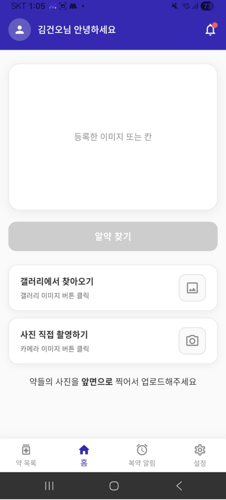
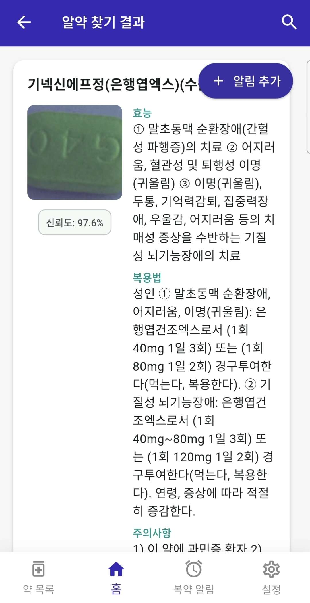
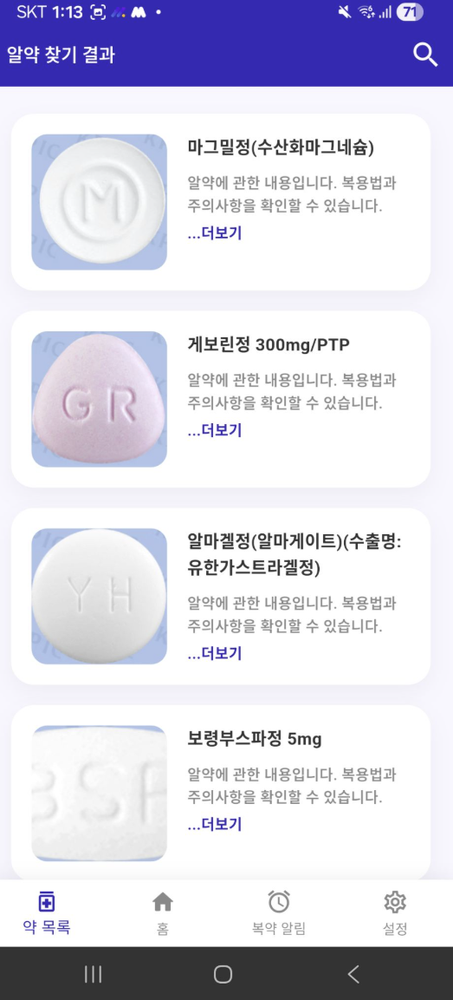
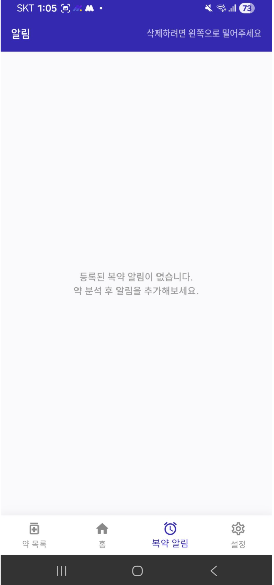
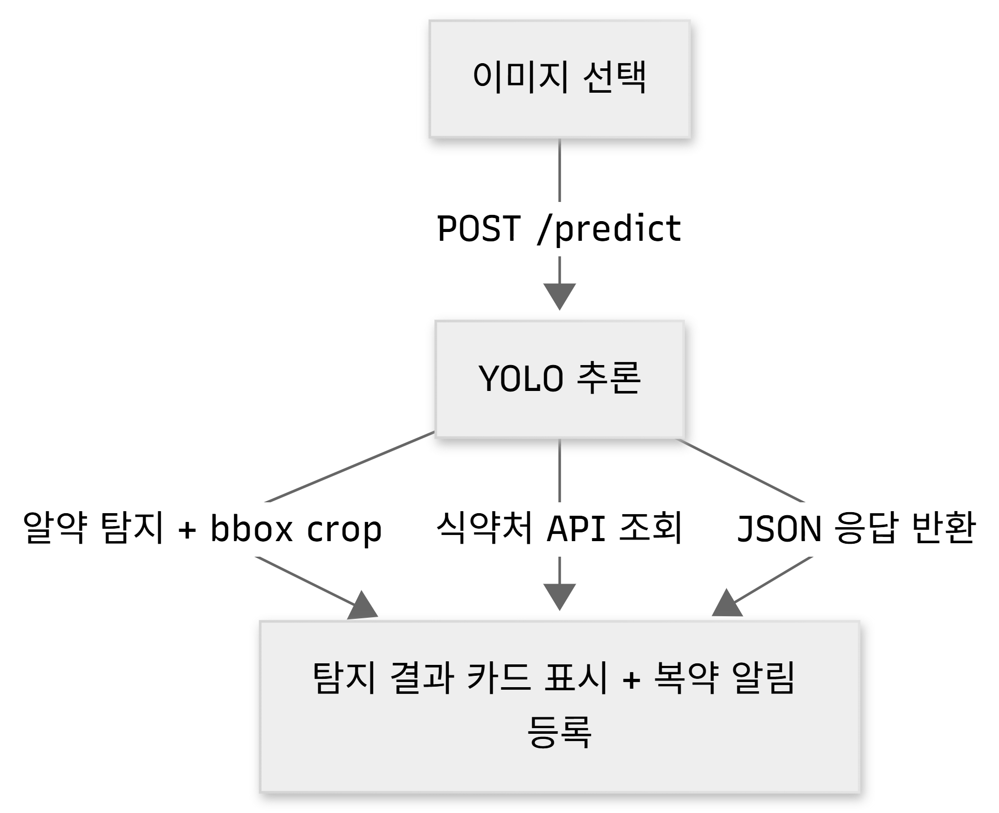

# 이게머약 💊 — 알약 인식 및 정보 조회 앱

스마트폰으로 알약을 촬영하면 YOLO 모델이 약을 인식하고, 식약처 API를 통해 효능·복용법·주의사항을 조회해주는 모바일 앱입니다.

[](https://youtu.be/b6sTlv_Z9cs)
> 👆 썸네일을 클릭하면 시연 영상으로 이동합니다.

---

## 팀원

<table>
  <tr>
    <td align="center">
      <br/>
      <b>김재헌(PM)</b>
    </td>
    <td align="center">
      <br/>
      <b>김건오</b>
    </td>
    <td align="center">
      <br/>
      <b>김재헌</b>
    </td>
    <td align="center">
      <br/>
      <b>임유빈</b>
    </td>
  </tr>
</table>

---

## 주요 기능

- **알약 인식** — 촬영 또는 갤러리 이미지로 알약 탐지
- **약 정보 조회** — 효능, 복용법, 주의사항 자동 조회
- **복약 알림** — 복약 시간 설정 및 알림 등록
- **약 목록** — 인식 가능한 전체 약품 목록 조회/검색 지원

<table>
  <tr>
    <td align="center" colspan="4"></td>
  </tr>
  <tr>
    <td align="center"><br/><b>홈</b></td>
    <td align="center"><br/><b>알약 찾기 결과</b></td>
    <td align="center"><br/><b>약 목록</b></td>
    <td align="center"><br/><b>복약 알림</b></td>
  </tr>
</table>

---

## 기술 스택

| 분류 | 기술 |
|------|------|
| 모바일 앱 |  |
| 서버 |    |
| AI 모델 |  |
| 약 정보 API | 식약처 제품허가정보 API, e약은요 API |
| 의존성 관리 |  |

---

## 모델 성능

| 지표 | 값 |
|------|----|
| mAP@0.5 | 0.9914 |
| mAP@0.75:0.95 | 0.9811 |
| F1 Score | 0.9948 |

> 모델 선정 과정 및 실험 결과는 [docs/](docs/)를 참고하세요.

---

## 데이터셋

| 데이터셋 | 출처 |
|---------|------|
| 경구약제 이미지 데이터 | [AI Hub](https://aihub.or.kr/aihubdata/data/view.do?currMenu=115&topMenu=100&dataSetSn=576) |

---

## 파이프라인



---

## 모델 학습 재현

```bash
# 의존성 설치
uv sync

# 학습 실행
uv run python tests/yolo_test/yolo_11s_test/yolo_11s_test.py
```

> 학습 완료 후 best 모델(mAP@0.75:0.95 기준)이 `outputs/yolo_11s/`에 자동 저장됩니다.

---

## 실행 방법

### 서버 실행 (PC)

```bash
# 의존성 설치
uv sync

# .env 설정 (.env.example 참고)
cp .env.example .env

# 서버 실행
uvicorn src.pill_lookup_api:app --host 0.0.0.0 --port 9000
```

### 앱 빌드 (Android APK)

```bash
cd pill_app
flutter pub get
flutter build apk
```

> `lib/screens/home_screen.dart`, `lib/screens/pill_list_screen.dart`의 서버 URL을 PC의 IP 주소로 변경 후 빌드하세요.
> 빌드된 APK는 `build/app/outputs/flutter-apk/app-release.apk`에 생성됩니다.

---

## 트러블슈팅

추가 데이터 통합 과정에서 발생한 문제들입니다.

**1. JSON 파일명 충돌 (`utils.py`)**
조합 이미지 1개당 약별 JSON 4개가 같은 파일명으로 덮어씌워져 1개만 남는 문제 발생. 이미지당 bbox가 1개만 잡히던 원인이었습니다.
→ 서브디렉터리 구조를 유지하며 저장하도록 로직을 수정해 해결.

**2. `fix_annotation_dir` 파일명 충돌 (`annotation_mapping.py`)**
서브디렉터리 구조를 무시하고 flat하게 복사하면서 같은 이름의 JSON이 덮어씌워짐.
→ `relative_to(input_dir)`로 서브디렉터리 경로를 보존해 저장하도록 수정해 해결.

**3. `make_category_map` KeyError (`model_utils.py`)**
추가 데이터 전용 클래스가 원본 어노테이션에 없어서 매핑 생성 시 KeyError 발생.
→ 매핑 테이블에 없는 클래스는 skip하도록 수정해 해결.

**4. submission row KeyError (`model_utils.py`)**
추가 데이터 클래스에 대한 YOLO 예측값이 매핑 테이블에 없어서 KeyError 발생.
→ 매핑에 없는 클래스의 예측값은 submission에서 제외하도록 수정해 해결.

**5. `category_id` 매핑 오류 (`model_utils.py`)**
`item_seq`(9자리 숫자)를 `category_id`로 제출하면서 score **0.12** 기록.
→ 원본 `category_id` 기준으로 매핑을 수정한 후 **0.987**까지 향상.

---

## 폴더 구조

```
Medicine_Project/
├── checkpoints/        # YOLO 모델 가중치
├── docs/               # 알약 도메인 지식, 발표자료, 최종 보고서
├── models/             # 모델 아키텍처 코드
├── pill_app/           # Flutter 앱
├── src/                # FastAPI 서버, 데이터 처리 코드
└── tests/              # 테스트 코드
```

---

## 📄 보고서 및 발표자료

- [최종 보고서 다운로드](docs/4팀_프로젝트_최종_보고서.pdf)
- 발표자료

---

## 📝 협업일지

| 이름 | 링크 |
|------|------|
| 김재헌 | [협업일지 다운로드](docs/협업일지_김재헌.pdf) |
| 김건오 |[협업일지 링크](https://www.notion.so/35945e30975580839de7cc92d91e0692) |
| 김재헌 |[협업일지 링크](https://www.notion.so/1-34843dd18cdc804fb29cf59d787d6d32?source=copy_link) |
| 임유빈 | |

